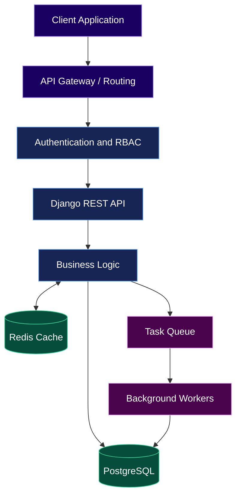
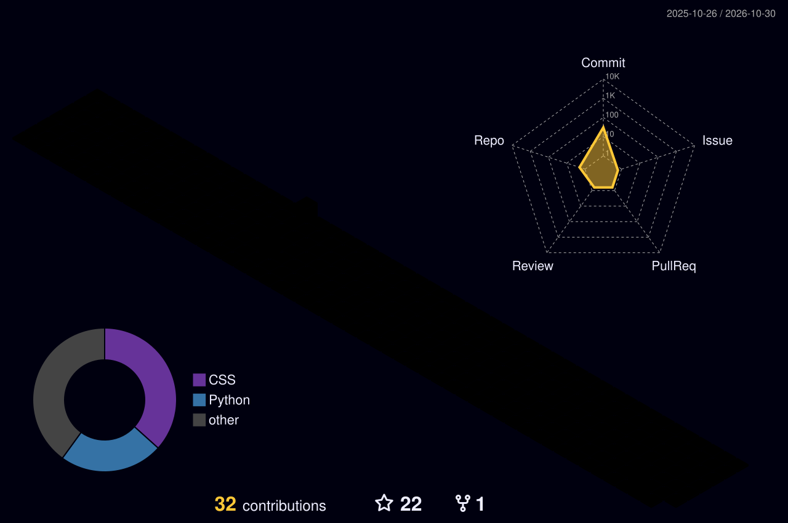

 <div align="center">


<br/>


</div>

---

<div align="center">

### `INITIALIZING DEVELOPER MODE...`


</div>

## 🧬 `01` — The Developer Behind the Code

Hey! I'm **Shashank Shekhar Tripathi**, a Python Backend Developer passionate about building SaaS products, backend systems, and useful software.

```python
class Developer:
    def __init__(self):
        self.name = "Shashank Tripathi"
        self.role = "Python Backend Developer"
        self.focus = [
            "Backend Engineering",
            "System Design",
            "Multi-Tenant SaaS",
            "API Architecture",
        ]
        self.current_stack = ["Python", "Django", "PostgreSQL"]
        self.mindset = "Build. Learn. Improve. Repeat."

    def build(self):
        return "Turning ideas into reliable software."
```

- ⚡ Building backend applications and REST APIs.
- 🏗️ Exploring scalable, multi-tenant SaaS architecture.
- 🗄️ Improving database design and query performance.
- 🔐 Working with authentication, authorization, and secure APIs.
- 🧠 Learning system design and distributed systems fundamentals.
- 🚀 Interested in AI-powered backend applications.

---

<div align="center">


## ⚙️ `02` — My Technology Universe

### 🐍 Backend Engineering


### 🗄️ Database & Caching


### 🌐 Frontend & Integration


### ☁️ Tools & Infrastructure


</div>

**Backend toolkit:** Django REST Framework · Django ORM · JWT · RBAC · PostgreSQL schemas · Swagger/OpenAPI · API integration · Database migrations.

*Keep only the technologies you have actually used and can confidently discuss.*

---

<div align="center">


## 🚀 `03` — Projects From My Universe

</div>

<table>
<tr>
<td width="50%" valign="top">

<div align="center">

### 🪐 ShankFlow CRM

<a href="https://shankflow.online">

</a>

</div>

A multi-tenant SaaS CRM built around company workspaces and business workflows.

**Features**

- 🏢 Tenant-aware company workspaces
- 📊 Leads, deals, and sales pipelines
- 👥 Team and role management
- 🔐 JWT authentication and access control
- 📈 Dashboards and analytics

**Stack:** Python · Django · PostgreSQL · Next.js

<sub>🔒 Source code is private.</sub>

</td>
<td width="50%" valign="top">

<div align="center">

### 🛡️ WebVScan

<a href="https://webvscan.onrender.com">

</a>

</div>

A web security scanning project exploring automated crawling, scan workflows, and reporting.

**Features**

- 🔎 Website crawling and scan operations
- ⚙️ Backend API endpoints
- 📋 Scan result management
- 📄 Report generation
- 🔄 Background task processing

**Stack:** Python · Django REST Framework · Celery · Redis

<sub>🔒 Source code is private.</sub>

</td>
</tr>
</table>

---

<div align="center">


## 🏗️ `04` — System Design Lab


</div>

| Domain | Concepts I'm Exploring |
|---|---|
| API Design | REST, resource modeling, pagination, filtering, versioning, OpenAPI |
| Architecture | Layered architecture, modular monoliths, service boundaries, separation of concerns |
| Database Engineering | Normalization, ER diagrams, indexing, transactions, query optimization, connection pooling |
| Multi-Tenant SaaS | Tenant isolation, schema-based tenancy, tenant-aware middleware |
| Authentication | JWT, RBAC, permissions, least privilege, token lifecycle |
| Caching | Redis, cache-aside, TTL, cache invalidation |
| Async Systems | Celery, task queues, retries, scheduling, idempotency |
| Scalability | Stateless APIs, horizontal scaling, load balancing, bottleneck analysis |
| Reliability | Timeouts, retries, logging, health checks, graceful error handling |
| Performance | N+1 query prevention, profiling, pagination, efficient ORM queries |
| Design Principles | SOLID, DRY, KISS, dependency inversion, modularity |
| Delivery | Git, CI/CD fundamentals, environment configuration, deployment and monitoring |

### 🔮 Backend Architecture Concept



<sub>Illustrative architecture for learning; not a claim that every component is deployed in both projects.</sub>

---

<div align="center">


## 🐍 `05` — My Contributions in Motion

<!-- Generated by the GitHub Actions workflow described below. -->


<br/>



</div>

---

<div align="center">

## 📊 `06` — GitHub Statistics


<br/>


<br/>


</div>

---

<div align="center">


## 🎯 `07` — Currently Leveling Up


</div>

- [ ] Stronger automated testing and test coverage.
- [ ] Advanced SQL and PostgreSQL performance tuning.
- [ ] Scalable API and multi-tenant architecture.
- [ ] System design interview preparation.
- [ ] CI/CD, observability, and reliable deployments.
- [ ] AI API integration into backend applications.

---

<div align="center">

## 🌐 Connect With Me

<a href="https://github.com/shashank-shekhar-tripathi">

</a>

<a href="mailto:tripathiji931@gmail.com">

</a>

<a href="https://www.linkedin.com/">

</a>

<br/><br/>


### `BUILD • BREAK • LEARN • REPEAT`

<sub>Designed in neon. Powered by curiosity. Built with Python.</sub>

</div>
